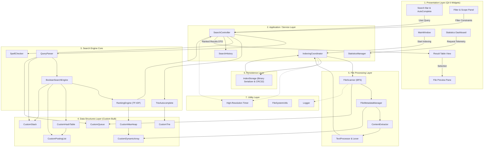
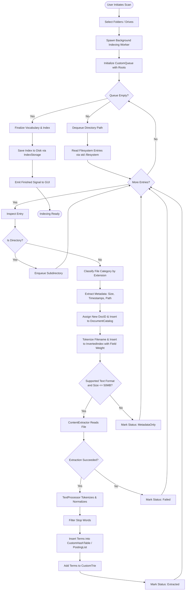
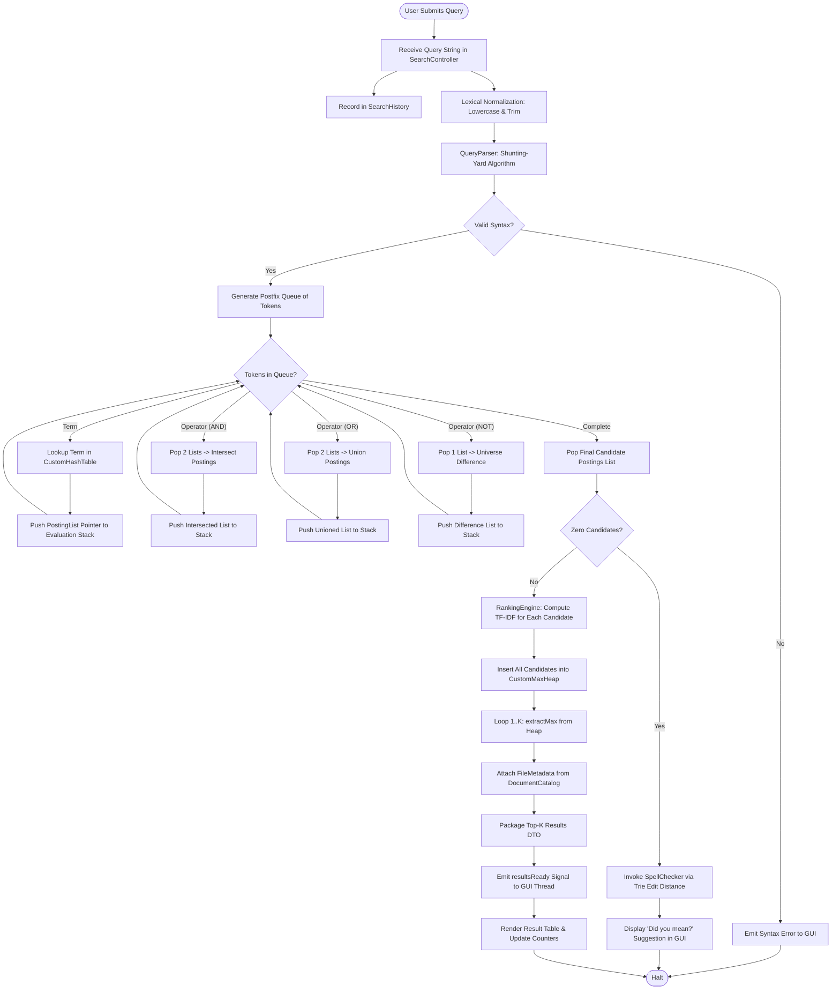
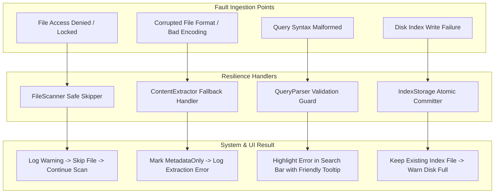

# Software Architecture Specification (ARCHITECTURE)
## Project: Universal Smart Search Engine
### Release 1 — Local Universal File Search Engine
**Document Version:** 1.0.0  
**Target Platform:** Windows Desktop (C++17 / MSVC 2022 x64 / Qt 6 Widgets / CMake)  
**Academic Context:** University Data Structures & Algorithms Coursework  
**Status:** Approved for DSA Baseline & Implementation  

---

## 1. Architecture Overview

### 1.1 Architectural Philosophy
The Universal Smart Search Engine architecture is governed by four core tenets:
1. **Algorithmic Primacy:** All core search, indexing, ranking, and autocomplete algorithms rely directly on custom-engineered Data Structures and Algorithms (DSA). Standard Template Library (STL) containers are strictly prohibited from serving as the core index, posting lists, lookup tables, priority queues, tries, or query stacks.
2. **Layered Separation of Concerns:** A strict unidirectional dependency model isolates presentation (Qt Widgets) from application orchestration, core information retrieval algorithms, filesystem processing, and persistent serialization.
3. **Non-Blocking Asynchronous Operations:** All disk I/O, recursive directory traversal, text extraction, and indexing tasks are completely offloaded from the UI thread to background worker threads using worker-object Qt signals/slots or modern task constructs.
4. **Resilient Memory Ownership:** Strict RAII (Resource Acquisition Is Initialization) semantics, well-defined single-ownership hierarchies, and custom smart-pointer/node memory management prevent memory leaks and dangling pointers across long-running desktop sessions.

### 1.2 The Layered Architecture

```
┌────────────────────────────────────────────────────────────────────────┐
│                        1. Presentation Layer                           │
│     (Qt 6 Widgets: MainWindow, SearchBar, ResultView, PreviewPane)     │
└───────────────────────────────────┬────────────────────────────────────┘
                                    │ Qt Signals & Slots / Value DTOs
                                    ▼
┌────────────────────────────────────────────────────────────────────────┐
│                    2. Application / Service Layer                      │
│        (SearchController, IndexingCoordinator, StatisticsManager)      │
└──────────────────┬─────────────────────────────────┬───────────────────┘
                   │                                 │
                   ▼                                 ▼
┌──────────────────────────────────┐ ┌──────────────────────────────────┐
│      3. Search Engine Core       │ │    5. File Processing Layer      │
│  (QueryParser, BooleanEngine,    │ │ (FileScanner, MetadataManager,   │
│   RankingEngine, Autocomplete,   │ │  ContentExtractor, TextProcessor)│
│   SpellChecker)                  │ └─────────────────┬────────────────┘
└──────────────────┬───────────────┘                   │
                   │                                   │
                   └─────────────────┬─────────────────┘
                                     │
                                     ▼
┌────────────────────────────────────────────────────────────────────────┐
│                      4. Data Structures Layer                          │
│   (Custom HashTable, PostingList, Trie, MaxHeap, Stack, Queue, Array)  │
└────────────────────────────────────┬───────────────────────────────────┘
                                     │
                                     ▼
┌────────────────────────────────────────────────────────────────────────┐
│                        6. Persistence Layer                            │
│                 (IndexStorage, BinarySerializer)                       │
└────────────────────────────────────┬───────────────────────────────────┘
                                     │
                                     ▼
┌────────────────────────────────────────────────────────────────────────┐
│                          7. Utility Layer                              │
│         (Logger, FileSystemUtils, Timer, StringEncodingUtils)          │
└────────────────────────────────────────────────────────────────────────┘
```

#### Layer Responsibilities:
1. **Presentation Layer (Qt 6 Widgets):** Renders UI controls, captures user keystrokes/actions, displays result tables, formats telemetry data, and hosts preview widgets. Contains zero business logic, zero direct filesystem scans, and zero direct data structure manipulations.
2. **Application / Service Layer:** Serves as the central mediator. Coordinates background scanning tasks, converts raw UI inputs into query commands, orchestrates worker threads, manages engine state, and dispatches UI notifications.
3. **Search Engine Core:** Encapsulates information retrieval logic. Normalizes terms, parses Boolean grammar into postfix syntax trees, executes posting list intersections/unions/differences, computes TF-IDF scores, and extracts Top-$K$ documents.
4. **Data Structures Layer:** The foundational algorithmic bedrock. Houses pure, custom-built C++17 implementations of all required data structures: `CustomHashTable`, `CustomPostingList`, `CustomTrie`, `CustomMaxHeap`, `CustomStack`, `CustomQueue`, and `CustomDynamicArray`.
5. **File Processing Layer:** Handles recursive directory traversal, file classification, operating system metadata queries, character decoding, format-specific content extraction, and lexical tokenization.
6. **Persistence Layer:** Converts in-memory catalogs, posting structures, and vocabulary maps into durable on-disk binary format (`.idx`) with CRC validation, and restores them on startup.
7. **Utility Layer:** Provides cross-cutting platform facilities: high-resolution benchmarking timers, thread-safe file loggers, UTF-8/UTF-16 encoding converters, and path manipulators.

---

## 2. Major Modules

### 2.1 FileScanner
- **Responsibility:** Traverses user-selected directories and logical drive roots recursively using a queue-based Breadth-First Search (BFS) algorithm. Detects path validity, catches OS permission errors, and feeds discovered paths to the cataloging pipeline.
- **Inputs:** List of root directory paths (`std::vector<std::string>`), scan cancellation token.
- **Outputs:** Stream of raw file paths emitted via batch callbacks or Qt signals.
- **Dependencies:** `CustomQueue`, `FileSystemUtils`, `Logger`.
- **Internal Components:** Directory queue, visited path registry (cycle/symlink suppressor), exception isolation wrapper.
- **Communication:** Emits `fileDiscovered(string)` and `scanProgress(int, int)` to `IndexingCoordinator`.

### 2.2 FileMetadataManager
- **Responsibility:** Queries filesystem attributes for discovered paths, assigns category tags, and constructs normalized `FileMetadata` records.
- **Inputs:** Discovered file path.
- **Outputs:** Fully populated `FileMetadata` record.
- **Dependencies:** `std::filesystem`, `DocumentCatalog`.
- **Internal Components:** Extension classifier map, timestamp normalizer, file size reader.
- **Communication:** Invoked directly by `IndexingCoordinator` to populate `DocumentCatalog`.

### 2.3 ContentExtractor
- **Responsibility:** Inspects file format and extracts readable text streams. Manages extractor plugin strategies (Plain Text, Source Code, extensible Document parsers).
- **Inputs:** File path, `FileCategory`.
- **Outputs:** Decoded UTF-8 text buffer or extraction failure code.
- **Dependencies:** `Logger`, file I/O streams.
- **Internal Components:** TextExtractor, CodeExtractor, DocumentExtractor stub/interface.
- **Communication:** Called by `IndexingCoordinator`; yields text to `TextProcessor`.

### 2.4 TextProcessor
- **Responsibility:** Performs lexical analysis on extracted text buffers and filenames: tokenization, lowercase normalization, punctuation removal, token length thresholding (2–45 chars), and stop-word filtering.
- **Inputs:** Raw text buffer, boolean flag indicating whether text originates from filename or content.
- **Outputs:** Stream/array of normalized token strings.
- **Dependencies:** `CustomHashTable` (for $O(1)$ stop-word set lookup).
- **Internal Components:** Lexer, stop-word hash set, ASCII/UTF-8 character sanitizer.
- **Communication:** Transmits tokens to `InvertedIndex` for posting list insertion.

### 2.5 DocumentCatalog
- **Responsibility:** Central registry for all discovered files. Assigns and maps sequential 32-bit `DocID`s ($1, 2, \dots, N$) to their corresponding `FileMetadata` structs.
- **Inputs:** `FileMetadata` objects.
- **Outputs:** Lookup by `DocID` in $O(1)$, lookup by path in $O(1)$ average time.
- **Dependencies:** `CustomDynamicArray<FileMetadata>`, `CustomHashTable<std::string, uint32_t>`.
- **Internal Components:** Dynamic array of metadata indexed by `DocID`, path-to-DocID hash table.
- **Communication:** Read by `SearchController`, `RankingEngine`, `BooleanSearchEngine`, and UI result views.

### 2.6 InvertedIndex
- **Responsibility:** The core information retrieval data structure. Maps distinct vocabulary terms to their respective `CustomPostingList` instances.
- **Inputs:** Term tokens and associated `DocID` with occurrence context (filename vs. content).
- **Outputs:** Pointer to `CustomPostingList` for any given term.
- **Dependencies:** `CustomHashTable<std::string, CustomPostingList*>`.
- **Internal Components:** Bucket array of collision chains, term count registry, total posting counter.
- **Communication:** Primary target for `TextProcessor` during indexing; queried by `BooleanSearchEngine` during search.

### 2.7 PostingList
- **Responsibility:** Stores an ordered sequence of `PostingNode`s, each recording a `DocID`, term frequency ($TF$), and field occurrence flags.
- **Inputs:** `DocID`, frequency increment.
- **Outputs:** Ordered linked sequence of postings; iterators for merge-intersection and merge-union.
- **Dependencies:** `CustomSinglyLinkedList`.
- **Internal Components:** Head pointer, tail pointer, length counter (Document Frequency $DF$).
- **Communication:** Contained within `InvertedIndex`; manipulated during Boolean query evaluation.

### 2.8 TrieAutocomplete
- **Responsibility:** Maintains the corpus vocabulary in a prefix trie to provide instant keystroke autocompletion and frequency-ranked query completions.
- **Inputs:** Indexed vocabulary words during ingestion; user query prefix during search.
- **Outputs:** Top 5 suggested word completions.
- **Dependencies:** `CustomTrie`, `CustomMaxHeap` (for Top-5 suggestion extraction).
- **Internal Components:** 26/128-way Trie nodes, frequency counters, DFS suggestion collector.
- **Communication:** Receives terms from `InvertedIndex`; directly queried by `SearchController` on UI text changes.

### 2.9 SpellChecker
- **Responsibility:** Provides "Did you mean?" suggestions when a query term yields zero or negligible results. Explores vocabulary within Levenshtein edit distance $\le 2$.
- **Inputs:** Unrecognized search token.
- **Outputs:** Best matching replacement term(s) ranked by edit distance and term frequency.
- **Dependencies:** `TrieAutocomplete`, `InvertedIndex`.
- **Internal Components:** Dynamic programming Levenshtein matrix / recursive Trie branch exploration.
- **Communication:** Invoked by `SearchController` upon zero-hit search results.

### 2.10 QueryParser
- **Responsibility:** Parses user search strings, tokenizes search operators (`AND`, `OR`, `NOT`, `(`, `)`), enforces operator precedence, and converts infix query expressions into Reverse Polish Notation (RPN).
- **Inputs:** Raw user query string.
- **Outputs:** Queue of postfix tokens or a syntax error structure.
- **Dependencies:** `CustomStack<Token>`, `CustomQueue<Token>`.
- **Internal Components:** Shunting-Yard parser, lexer, parenthesis matching validator.
- **Communication:** Receives query from `SearchController`; delivers RPN stream to `BooleanSearchEngine`.

### 2.11 BooleanSearchEngine
- **Responsibility:** Evaluates postfix Boolean query streams by popping operands, retrieving posting lists from `InvertedIndex`, and performing set operations:
  - `AND`: Linear two-pointer intersection.
  - `OR`: Linear two-pointer union.
  - `NOT`: Linear difference against full document universe.
- **Inputs:** Postfix token stream from `QueryParser`.
- **Outputs:** Candidate set of `DocID`s satisfying the Boolean constraints.
- **Dependencies:** `CustomStack<CustomPostingList*>`, `InvertedIndex`, `DocumentCatalog`.
- **Internal Components:** Set evaluation engine, posting list temporary allocator.
- **Communication:** Transmits candidate `DocID` set to `RankingEngine`.

### 2.12 RankingEngine
- **Responsibility:** Computes statistical relevance scores for all candidate documents matching a query using the TF-IDF formula with filename weight bonuses.
- **Inputs:** Candidate `DocID` list, parsed query terms, `InvertedIndex`, `DocumentCatalog`.
- **Outputs:** Array of `(DocID, float Score)` pairs passed to `MaxHeap`.
- **Dependencies:** `InvertedIndex`, `DocumentCatalog`, `CustomMaxHeap`.
- **Internal Components:** TF calculator, IDF calculator, score accumulator.
- **Communication:** Populates `CustomMaxHeap` to retrieve Top-$K$ results.

### 2.13 MaxHeap
- **Responsibility:** Priority queue structure that maintains candidate search results ordered by relevance score, enabling $O(M + K \log M)$ Top-$K$ retrieval.
- **Inputs:** Scored candidate entries `(DocID, Score)`.
- **Outputs:** Sorted Top-$K$ result list extracted via successive `extractMax()` operations.
- **Dependencies:** `CustomDynamicArray<HeapNode>`.
- **Internal Components:** Binary heap array, `heapifyUp`, `heapifyDown`, comparator logic with date tie-breaking.
- **Communication:** Delivers Top-$K$ results to `SearchController`.

### 2.14 IndexStorage
- **Responsibility:** Serializes and deserializes the entire search state (`DocumentCatalog`, `InvertedIndex`, `Trie` frequencies) to/from a compact binary file on disk (`search.idx`).
- **Inputs:** Memory structures on save; file path on load.
- **Outputs:** Binary file on disk, or populated memory structures.
- **Dependencies:** `DocumentCatalog`, `InvertedIndex`, `TrieAutocomplete`, `FileSystemUtils`.
- **Internal Components:** Binary reader/writer, CRC32 validator, schema version checker.
- **Communication:** Invoked during application startup and shutdown by `IndexingCoordinator`.

### 2.15 SearchHistory
- **Responsibility:** Tracks executed search queries, execution times, result counts, and timestamps. Maintains a circular or bounded list of recent searches persisted to a local JSON/text file.
- **Inputs:** Executed search record.
- **Outputs:** List of past queries for UI dropdown history.
- **Dependencies:** `CustomDynamicArray<HistoryEntry>`.
- **Internal Components:** Bounded buffer (max 100 entries), disk serializer.
- **Communication:** Updated by `SearchController` upon query submission.

### 2.16 SearchController
- **Responsibility:** The primary orchestration controller bridging the GUI presentation and the search engine core. Handles query dispatching, filter application, autocomplete triggering, spell correction routing, and history logging.
- **Inputs:** User events from GUI (search text, filter changes, autocomplete requests).
- **Outputs:** Clean Data Transfer Objects (DTOs) sent to GUI for display.
- **Dependencies:** `QueryParser`, `BooleanSearchEngine`, `RankingEngine`, `TrieAutocomplete`, `SpellChecker`, `SearchHistory`, `DocumentCatalog`.
- **Internal Components:** Result formatter, filter predicate evaluator, query execution stopwatch.
- **Communication:** Connects to Qt GUI via signals/slots; coordinates core search modules.

### 2.17 StatisticsManager
- **Responsibility:** Aggregates and maintains telemetry on the engine's internal state: document count, vocabulary size, total postings, memory usage, load factors, scan durations, and category distributions.
- **Inputs:** Telemetry queries from UI or updates from indexer.
- **Outputs:** `EngineStatisticsDTO` containing formatted telemetry metrics.
- **Dependencies:** `InvertedIndex`, `DocumentCatalog`, `TrieAutocomplete`.
- **Internal Components:** Memory estimator, bucket distribution counter.
- **Communication:** Queried by GUI Statistics dialog.

### 2.18 Qt GUI
- **Responsibility:** Implements the complete desktop user interface using Qt 6 Widgets.
- **Inputs:** User mouse/keyboard inputs.
- **Outputs:** Visual rendering on screen.
- **Dependencies:** Qt 6 (`QtWidgets`, `QtGui`, `QtCore`).
- **Internal Components:** `MainWindow`, `SearchWidget`, `ResultTableWidget`, `FilePreviewWidget`, `FilterPanelWidget`, `StatsDialog`.
- **Communication:** Communicates strictly with `SearchController` and `IndexingCoordinator` via Qt signals and slots.

---

## 3. Architecture Diagrams

### 3.1 High-Level System Architecture
The overall layered system architecture showing the flow of control and data between layers:



---

### 3.2 Component Diagram
Illustrates the concrete components, their provided/required interfaces, and data packaging:

```mermaid
graph LR
    subgraph UI_Component["GUI Component"]
        GUI["Qt6 Widgets GUI"]
    end

    subgraph Controller_Component["Service Controller Component"]
        Ctrl["SearchController & Coordinator"]
    end

    subgraph Retrieval_Component["Retrieval Engine Component"]
        Parser["Query Parser"]
        BoolEngine["Boolean Engine"]
        Ranker["TF-IDF Ranker"]
        Suggester["Trie & Spell Suggester"]
    end

    subgraph Catalog_Component["Index & Catalog Component"]
        DocCat["Document Catalog"]
        InvIdx["Inverted Index"]
    end

    subgraph Ingestion_Component["Ingestion & Extraction Component"]
        Scanner["File Scanner"]
        MetaMgr["Metadata Manager"]
        Extractor["Content Extractor"]
        Lexer["Text Processor"]
    end

    subgraph Storage_Component["Storage Component"]
        Storage["Index Storage Engine"]
    end

    %% Wiring
    GUI <==>|Signals / Slots (DTOs)| Ctrl
    Ctrl --> Parser
    Ctrl --> Suggester
    Parser --> BoolEngine
    BoolEngine --> InvIdx
    BoolEngine --> Ranker
    Ranker --> InvIdx
    Ranker --> DocCat
    Suggester --> InvIdx

    Scanner --> MetaMgr
    MetaMgr --> DocCat
    MetaMgr --> Extractor
    Extractor --> Lexer
    Lexer --> InvIdx

    Storage <==>|Disk Read / Write| DocCat
    Storage <==>|Disk Read / Write| InvIdx
```

---

### 3.3 Module Dependency Diagram (Strictly Non-Circular)
Confirms a strictly acyclic, directed graph of dependencies:

```mermaid
graph TD
    QtGUI["Qt GUI"] --> SearchController["SearchController"]
    QtGUI --> IndexingCoordinator["IndexingCoordinator"]
    
    SearchController --> QueryParser["QueryParser"]
    SearchController --> BooleanSearchEngine["BooleanSearchEngine"]
    SearchController --> RankingEngine["RankingEngine"]
    SearchController --> TrieAutocomplete["TrieAutocomplete"]
    SearchController --> SpellChecker["SpellChecker"]
    SearchController --> SearchHistory["SearchHistory"]
    SearchController --> DocumentCatalog["DocumentCatalog"]

    IndexingCoordinator --> FileScanner["FileScanner"]
    IndexingCoordinator --> FileMetadataManager["FileMetadataManager"]
    IndexingCoordinator --> ContentExtractor["ContentExtractor"]
    IndexingCoordinator --> TextProcessor["TextProcessor"]
    IndexingCoordinator --> InvertedIndex["InvertedIndex"]
    IndexingCoordinator --> DocumentCatalog["DocumentCatalog"]
    IndexingCoordinator --> IndexStorage["IndexStorage"]

    BooleanSearchEngine --> InvertedIndex
    BooleanSearchEngine --> CustomStack["CustomStack"]
    BooleanSearchEngine --> PostingList["CustomPostingList"]

    RankingEngine --> InvertedIndex
    RankingEngine --> DocumentCatalog
    RankingEngine --> CustomMaxHeap["CustomMaxHeap"]

    TrieAutocomplete --> CustomTrie["CustomTrie"]
    SpellChecker --> CustomTrie

    InvertedIndex --> CustomHashTable["CustomHashTable"]
    InvertedIndex --> PostingList
    PostingList --> CustomSinglyLinkedList["CustomSinglyLinkedList"]

    DocumentCatalog --> CustomDynamicArray["CustomDynamicArray"]
    DocumentCatalog --> CustomHashTable

    FileScanner --> CustomQueue["CustomQueue"]
    QueryParser --> CustomStack
    QueryParser --> CustomQueue

    IndexStorage --> DocumentCatalog
    IndexStorage --> InvertedIndex
    IndexStorage --> FileSystemUtils["FileSystemUtils"]

    %% Leaf Utility dependencies
    FileScanner --> FileSystemUtils
    IndexingCoordinator --> Logger["Logger"]
    SearchController --> Logger
```



---

### 3.4 File Indexing Flow
Demonstrating both the extractable content path and the metadata-only fallback path:



---

### 3.5 Search Execution Flow
Detailed progression from raw user keystrokes to Top-$K$ GUI presentation:



---

### 3.6 Application Startup Flow
Loading persisted binary state, validating integrity, and handling corruptions:

```mermaid
flowchart TD
    StartApp([Launch Application]) --> InitGUI[Initialize Qt GUI & MainWindow]
    InitGUI --> CheckIndexExists{Does search.idx Exist?}
    
    CheckIndexExists -- No --> PromptUser[Prompt User to Select Folders for Initial Index]
    PromptUser --> Standby([Idle State: Ready for Scan])

    CheckIndexExists -- Yes --> OpenFile[IndexStorage Opens Binary File]
    OpenFile --> ReadHeader[Read Magic Byte 'SMRT' & Version]
    ReadHeader --> HeaderValid{Header & Version Valid?}
    
    HeaderValid -- No --> CorruptNotice[Show Alert: Incompatible / Corrupt Index]
    CorruptNotice --> OfferRebuild[Offer Full Rebuild] --> PromptUser

    HeaderValid -- Yes --> CheckCRC[Compute CRC32 Checksum over Data Payload]
    CheckCRC --> CRCMatch{Checksum Matches?}
    
    CRCMatch -- No --> CorruptNotice
    
    CRCMatch -- Yes --> DeserializeCat[Deserialize DocumentCatalog into Memory]
    DeserializeCat --> DeserializeIdx[Deserialize InvertedIndex & PostingLists]
    DeserializeIdx --> RebuildTrie[Rebuild CustomTrie from Loaded Vocabulary]
    
    RebuildTrie --> LoadHistory[Load SearchHistory File]
    LoadHistory --> UpdateStats[Update Statistics Dashboard with Restored Counts]
    UpdateStats --> ReadyUI[Update UI Status: 'Ready (Corpus Loaded)']
    ReadyUI --> Active([Ready for Instant Search])
```

---

### 3.7 Error Handling Flow
Demonstrating how faults in filesystem access, extraction, query parsing, and disk I/O are handled cleanly:



---

## 4. Important Design Decisions

### Decision 1: Unified Inverted Index vs. Separate Metadata/Content Indexes
- **Options Considered:**
  - *Option A:* Build two distinct inverted indexes—one for filename/path terms, and one for document body content terms.
  - *Option B (Recommended):* Build a single, unified Inverted Index where each posting node maintains a field occurrence bitmask (e.g., `FIELD_FILENAME = 0x01`, `FIELD_CONTENT = 0x02`).
- **Trade-off Analysis:**
  - *Option A* doubles the hash table memory overhead, requires two independent lookups per term during Boolean evaluation, and complicates Boolean cross-field logic (e.g., filename contains "test" AND body contains "report").
  - *Option B* keeps all occurrences unified, allows single-pass hash lookups, enables identical Boolean query execution regardless of term origin, and applies field scoring weights ($W_{filename} = 5.0$, $W_{content} = 1.0$) during the TF-IDF phase.
- **Architectural Decision:** **Option B — Unified Inverted Index with Field Bitmask.**

### Decision 2: Should Filename Terms and Content Terms Share the Same Posting Structure?
- **Options Considered:**
  - *Option A:* Different posting types for filename vs. content.
  - *Option B (Recommended):* Standardized unified `PostingNode` explicitly storing independent frequencies: `uint32_t docId`, `uint16_t bodyTermFreq`, `uint16_t nameTermFreq`, `uint8_t fieldMask`, explicit 7-byte alignment padding, and `PostingNode* next`.
- **Trade-off Analysis:**
  - Under MSVC 2022 x64, an 8-byte pointer (`next`) forces structure alignment to an 8-byte boundary. A verified x64 memory layout:
    $$4\ \text{bytes } (\text{docId}) + 2\ \text{bytes } (\text{bodyTermFreq}) + 2\ \text{bytes } (\text{nameTermFreq}) + 1\ \text{byte } (\text{fieldMask}) + 7\ \text{bytes } (\text{padding}) + 8\ \text{bytes } (\text{next}) = \mathbf{24\ \text{bytes}}$$
  - Providing independent `nameTermFreq` and `bodyTermFreq` allows the ranking engine to compute field-weighted TF-IDF without re-reading or string-searching filenames at query time. Unifying this into one structure ensures merge-intersection and union routines remain strictly uniform across all query types.
- **Architectural Decision:** **Option B — Unified 24-Byte PostingNode with Independent Field Frequencies.**

### Decision 3: How Non-Text Files Participate in Search and Ranking
- **Options Considered:**
  - *Option A:* Exclude non-text files from the Inverted Index entirely and search them via linear scans of the `DocumentCatalog`.
  - *Option B (Recommended):* Tokenize the filename and path of all files (including images, video, audio, archives, binaries) into the unified Inverted Index.
- **Trade-off Analysis:**
  - *Option A* makes media searches noticeably slower ($O(N)$ linear scan over 100k files) and breaks unified Boolean queries like `sunset AND .png`.
  - *Option B* allows images and videos to be retrieved instantly in $O(1)$ through the Inverted Index while participating in TF-IDF ranking through filename term frequency.
- **Architectural Decision:** **Option B — Full Inclusion of Non-Text Filename Tokens in Inverted Index.**

### Decision 4: Document ID (DocID) Assignment & Identity Model
- **Options Considered:**
  - *Option A:* 64-bit cryptographic hash (e.g., MurmurHash or SHA-256) of the canonical file path.
  - *Option B (Recommended):* Dual identity architecture: Persistent identity via canonical absolute path string in `DocumentCatalog` string pool; runtime indexation via dense sequential 32-bit unsigned integers ($1, 2, 3, \dots, N$).
- **Trade-off Analysis:**
  - Dense sequential integers permit direct indexing into `CustomDynamicArray` in $O(1)$ without secondary mapping, reduce posting list memory consumption by 50% compared to 64-bit IDs, and allow compact bitset operations.
  - At runtime, `DocID` values are strictly monotonic and never reused during an active session, preventing dangling pointer traps and race conditions.
- **Architectural Decision:** **Option B — Dual Identity with Dense Monotonic 32-bit DocIDs.**

### Decision 5: Trie Autocomplete Persistence vs. Runtime Vocabulary Reconstruction
- **Options Considered:**
  - *Option A:* Serialize the complete Trie node graph (pointers, children) to disk.
  - *Option B (Recommended):* Reconstruct the Trie at startup by reading unique vocabulary keys directly from the deserialized Inverted Index.
- **Trade-off Analysis:**
  - Serializing a pointer-heavy Trie requires complex pointer re-swizzling, increases disk index file size by 300%, and creates fragility across binary formats.
  - Reconstructing from 50,000 vocabulary words takes less than $40\ \text{ms}$ of CPU time during startup and requires zero additional disk storage.
- **Architectural Decision:** **Option B — Runtime Reconstruction of Trie from Inverted Index Vocabulary.**

### Decision 6: Modified and Deleted File Detection Strategy
- **Options Considered:**
  - *Option A:* Full cryptographic hash (SHA-256) comparison of all file contents on every refresh.
  - *Option B (Recommended):* Fast metadata comparison: check file existence, size, and last modification timestamp (`last_write_time`) against the stored catalog.
- **Trade-off Analysis:**
  - *Option A* requires reading gigabytes of file data on every startup, rendering incremental updates unusable for large collections.
  - *Option B* verifies 100,000 files in under $200\ \text{ms}$ using OS directory attributes. If and only if the timestamp or size changes is the file re-read.
- **Architectural Decision:** **Option B — Fast Timestamp and Size Delta Verification.**

### Decision 7: Partial Index Rebuilding, Tombstone Invalidation & Reference Remapping
- **Options Considered:**
  - *Option A:* Full index wipe and total re-index whenever a single file changes.
  - *Option B (Recommended):* Soft tombstone invalidation during active sessions coupled with two-pass reference remapping compaction upon persistence.
- **Trade-off Analysis:**
  - *Option A* makes incremental updates unusable on large corpora ($> 100,000$ files).
  - *Option B* achieves sub-second incremental updates: modified/deleted files mark the old `DocID` as tombstoned (`is_active = 0`), and modified files receive a new monotonic `DocID`. At query time, tombstoned documents are filtered in $O(1)$.
  - **Reference Remapping Guarantee:** During index persistence or explicit maintenance, the compactor builds an ID translation table (`remap[oldDocId] -> newDocId`), prunes tombstoned posting nodes, and updates surviving node `docId` values in-place, mathematically guaranteeing that zero invalid or dangling references remain in the Inverted Index.
- **Architectural Decision:** **Option B — Soft Invalidation with Guaranteed Reference Remapping Compaction.**

### Decision 8: Indexing Concurrency, Worker Lifecycle & GUI Isolation
- **Options Considered:**
  - *Option A:* Periodic calls to `QCoreApplication::processEvents()` inside a synchronous indexing loop.
  - *Option B (Recommended):* Isolate the `IndexingWorker` on a dedicated `QThread` with unidirectional communication using immutable value Data Transfer Objects (DTOs) via Qt Signals and Slots.
- **Trade-off Analysis:**
  - *Option A* leads to UI stuttering, recursion issues in event loops, and fragile cancellation.
  - *Option B* isolates heavy disk I/O and CPU tokenization entirely on a worker thread. The GUI targets smooth 60 FPS responsiveness during active indexing.
  - **Lifecycle & Shutdown:** The worker thread is managed by `IndexingCoordinator`. Cancellation is triggered by an atomic flag (`std::atomic<bool> m_cancelRequested`). On application exit, a graceful rendezvous (`workerThread.quit(); workerThread.wait(3000);`) ensures zero dangling thread executions or memory leaks.
- **Architectural Decision:** **Option B — Dedicated Worker Thread via `QThread` with Atomic Cancellation and Value DTOs.**

### Decision 9: Separation of File Previews from Search Indexing
- **Options Considered:**
  - *Option A:* Store full document text in the index file so previews load instantly without disk access.
  - *Option B (Recommended):* Store only metadata and posting offsets in the index; read full file text from disk on demand when the user selects a result in the preview pane.
- **Trade-off Analysis:**
  - *Option A* explodes index file size from tens of megabytes to tens of gigabytes, exhausting RAM.
  - *Option B* keeps the index compact and memory-efficient. Reading a single selected 50 KB file from SSD takes less than $1\ \text{ms}$ on demand.
- **Architectural Decision:** **Option B — On-Demand File Reading for Previews.**

### Decision 10: Handling Massive Files (> 50 MB)
- **Options Considered:**
  - *Option A:* Read entire file into a contiguous memory buffer regardless of size.
  - *Option B (Recommended):* Streaming buffer with a hard 50 MB threshold: index the first 50 MB of text and gracefully mark the record as `Truncated`.
- **Trade-off Analysis:**
  - Unbounded reads risk Out-Of-Memory (OOM) crashes when encountering multi-gigabyte log files or ISOs. A 50 MB text limit accommodates > 10,000 pages of text while preserving absolute memory safety.
- **Architectural Decision:** **Option B — Streaming Ingestion with 50 MB Safety Cap.**

### Decision 11: Separation of Thumbnail Generation from File Indexing
- **Options Considered:**
  - *Option A:* Synchronously decode and generate image/video thumbnails during the initial directory traversal and indexing pass.
  - *Option B (Recommended):* Completely decouple thumbnail generation: index only the file path and metadata during scanning; generate and cache thumbnails on demand asynchronously when results are rendered in the GUI.
- **Trade-off Analysis:**
  - *Option A* slows down indexing by $50\times$ to $100\times$, as decoding thousands of high-resolution images consumes vast CPU cycles and blows up initial indexing memory.
  - *Option B* keeps the indexing pipeline blazingly fast ($> 1,000$ files/sec), reserving thumbnail decoding strictly for the 50 results currently visible in the user's viewport.
- **Architectural Decision:** **Option B — Lazy On-Demand Thumbnail Generation.**

### Decision 12: Reporting of Corrupted Files and Extraction Failures
- **Options Considered:**
  - *Option A:* Throw modal GUI dialog alerts or abort indexing whenever an unreadable or corrupt file is encountered.
  - *Option B (Recommended):* Silent resilience with aggregated telemetry: catch exceptions at the worker boundary, set `ExtractionStatus::Failed` on that document record, log a warning to the diagnostic logger, and report aggregate failure counts on the Indexing Dashboard.
- **Trade-off Analysis:**
  - *Option A* makes automated crawling unusable, as a single locked file or corrupted PDF would halt indexing of an entire 100,000-file drive.
  - *Option B* provides 100% crawl resilience, ensuring all valid files are indexed while transparently presenting corrupt file counts to the user in the telemetry view.
- **Architectural Decision:** **Option B — Resilient Soft Fallback with Telemetry Aggregation.**

---

## 5. External Supporting Libraries & Technology Evaluation

To satisfy Section 2 of the system specifications, each potential supporting library is documented below with its role, integration complexity, and Windows/MSVC compatibility:

| Library | Primary Purpose & Module | Mandatory in R1? | Recommended Choice (Win/MSVC) | Integration Complexity | Licensing & Distribution |
| :--- | :--- | :---: | :--- | :---: | :--- |
| **PDF Text Extraction** | Extracting raw text from `.pdf` files (`ContentExtractor`) | Optional (Stubbed in R1) | **PDFium** (Google) or **Poppler-cpp** | Medium | Apache 2.0 / BSD (PDFium) or GPLv2 (Poppler); PDFium preferred for permissive distribution |
| **DOCX/PPTX/XLSX Extraction** | Extracting XML text streams from zipped Office files (`ContentExtractor`) | Optional (Stubbed in R1) | **miniz** (decompression) + **pugixml** (XML parsing) | Low | MIT (miniz & pugixml); lightweight header/source, zero DLL hassles |
| **Tesseract OCR** | Optical character recognition on scanned images (`ContentExtractor`) | Optional (Reserved for R3) | **tesseract-ocr 5.x** via vcpkg | High | Apache 2.0; requires trained data models (`tessdata`), heavy runtime footprint |
| **OpenCV** | Image processing, feature extraction, keyframe sampling (`FilePreviewWidget`) | Optional (Reserved for R3) | **OpenCV 4.x (World DLL)** | High | Apache 2.0; large binary footprint, best deferred past Release 1 |
| **FFmpeg** | Video/audio metadata extraction, thumbnail frame grabbing (`MediaPreview`) | Optional (Reserved for R4) | **FFmpeg 6.x (libavcodec, libavformat)** | High | LGPL / GPL; complex build setup on MSVC, interface stubbed in Release 1 |
| **Qt Multimedia** | Native audio and video playback within Qt preview docks (`GUI`) | Optional (Supported if available) | **Qt 6 Multimedia Module** (DirectShow / Media Foundation) | Low | LGPLv3; native to Qt 6 ecosystem, works out-of-the-box on Windows 10/11 |

*Architectural Recommendation:* For Release 1 university submission, the application relies on native C++17 implementations for text and code parsing, coupled with `pugixml` + `miniz` for DOCX if office indexing is activated. Heavy media libraries (OpenCV, FFmpeg, Tesseract) are abstracted behind clean plugin interfaces to keep the initial build lightweight and 100% self-contained.

---

## 6. Threading and Memory Architecture

### 6.1 Threading Model & Worker Lifecycle
The application employs a 2-tier asynchronous threading architecture:

```
┌────────────────────────────────────────────────────────┐
│                   GUI Thread (Main)                    │
│  - Qt Event Loop                                       │
│  - User Input & Search Bar Typing                      │
│  - Trie Autocomplete Queries (< 5 ms)                  │
│  - Rendering Result Table & Preview Dock               │
└───────────────┬────────────────────────▲───────────────┘
                │                        │
         Qt Signal (Start)        Qt Signal (Results / Progress DTOs)
                │                        │
┌───────────────▼────────────────────────┴───────────────┐
│              Background Worker Thread                  │
│  - FileScanner (Recursive Queue BFS)                   │
│  - ContentExtractor (File I/O)                         │
│  - TextProcessor (Tokenization & Stop Words)           │
│  - InvertedIndex Construction                          │
│  - Heavy Boolean Set Operations (for large corpora)    │
└────────────────────────────────────────────────────────┘
```

#### Detailed Thread Safety Protocols:
1. **Zero Shared Mutable State Across Threads:** The GUI thread never reads or mutates the `InvertedIndex` while the `IndexingWorker` is actively updating it.
2. **Double-Buffering & Snapshot Swapping:** During active background re-indexing, the worker operates on an isolated staging index. Upon completion, a pointer swap takes place inside an atomic mutex-protected critical section, or search queries wait on a read-write lock.
3. **Responsive Cancellation:** The worker thread regularly checks a `std::atomic<bool> m_cancelRequested` flag at the start of each directory and file iteration. If set, traversal stops immediately, resources are cleaned up, and a cancellation signal is emitted.
4. **GUI Communication via Immutable Value DTOs:** All search results, progress counts, and statistics transmitted from worker threads to the GUI thread are packaged as pure, immutable value Data Transfer Objects (`SearchResultDTO`, `EngineStatisticsDTO`, `IndexProgressDTO`). Pointers to internal engine nodes never cross thread boundaries.
5. **Graceful Application Shutdown:** When the user closes the application during active indexing, `MainWindow::closeEvent()` signals `cancelRequested = true` and waits for worker completion:
   ```cpp
   workerThread->quit();
   if (!workerThread->wait(3000)) {
       workerThread->terminate(); // Hard fallback after 3-second grace period
   }
   ```
6. **Error Propagation:** Worker errors (permission denied, disk full, corrupt files) are encapsulated in `std::error_code` or typed error signals (`indexError(QString, ErrorSeverity)`) rather than throwing exceptions across thread boundaries.

### 6.2 Memory Ownership & Lifecycle Management
- **Single Source of Truth:** `DocumentCatalog` owns all `FileMetadata` instances in a contiguous `CustomDynamicArray`. All other modules reference documents strictly via their lightweight 32-bit `DocID`.
- **Posting List Nodes:** `InvertedIndex` owns the `CustomPostingList` instances via its internal `CustomHashTable`. Each `CustomPostingList` owns its linked chain of `PostingNode`s and frees them in its destructor.
- **Query Evaluation Intermediate Lists:** Temporary posting lists created during Boolean set operations (`AND`, `OR`, `NOT`) are managed via an explicit RAII wrapper or stack arena, preventing leaks during complex expression evaluation.
- **Zero Raw Owning Pointers:** Where modern idioms apply, RAII wrappers ensure deep destruction. Destructors of custom data structures explicitly traverse and deallocate every dynamically allocated heap node.

---

## 7. Data Flow and Ownership

| Entity | Primary Owner | Secondary Accessors | Lifetime | Allocation Strategy |
| :--- | :--- | :--- | :--- | :--- |
| `FileMetadata` | `DocumentCatalog` | `SearchController`, UI View (via DTO) | Full Application Session | Heap block managed by `CustomDynamicArray` |
| `PostingNode` | `CustomPostingList` | `BooleanSearchEngine` (traversal) | Full Index Lifetime | Individual heap nodes / custom pool |
| `InvertedIndex` | `IndexingCoordinator` | `BooleanSearchEngine`, `RankingEngine` | Full Application Session | Custom Hash Table bucket array |
| `TrieNode` | `CustomTrie` | `TrieAutocomplete`, `SpellChecker` | Full Application Session | Dynamically allocated node tree |
| Query AST / Tokens | `QueryParser` | `BooleanSearchEngine` | Single Query Execution | Stack and temporary queue |
| Search Results | `SearchController` | Qt GUI Table View | Until next query execution | Value DTO containing Top-$K$ records |

---

## 8. Open Architecture Decisions Requiring Approval

The following architectural choices are explicitly documented for user alignment:

1. **[DECISION-REQ-01] PDF & Office Document Extractor Integration:**  
   *Current Architecture:* Text and source code files are parsed natively. For PDF and Office documents, the architecture defines clean abstract interfaces (`IPDFExtractor`, `IOfficeExtractor`). In Release 1, should we link lightweight open-source C++ extraction libraries (e.g., Poppler/PDFium, miniz/pugixml for DOCX), or leave them as stubbed mock extractors that degrade to `MetadataOnly` until Phase 2?  
   *Recommendation:* Use native plain-text/source code extraction in Release 1 with stubbed document extractors, keeping build dependencies zero-overhead for university submission.

2. **[DECISION-REQ-02] Binary Index Storage Format vs. Human-Readable JSON:**  
   *Current Architecture:* Custom compact binary format with CRC32 checksum.  
   *Alternative:* Plain-text / JSON serialized format.  
   *Trade-off:* Binary is 10x faster and 4x smaller, but cannot be inspected in a text editor.  
   *Recommendation:* Use binary format with a command-line `--dump-index` flag or diagnostic dump function for grading evaluation.
