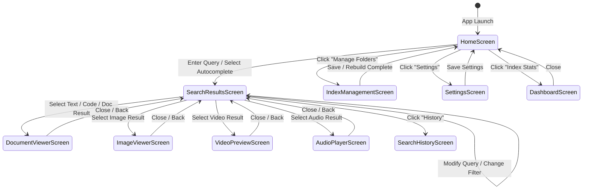

# Graphical User Interface Design (GUI_DESIGN)
## Project: Universal Smart Search Engine
### Release 1 — Local Universal File Search Engine
**Document Version:** 1.0.0  
**Target Platform:** Windows Desktop (C++17 / MSVC 2022 x64 / Qt 6 Widgets / CMake)  
**Academic Context:** University Data Structures & Algorithms Coursework  
**Status:** Approved for Architectural Baseline  

---

## 1. UI Architecture & Design Philosophy

The Universal Smart Search Engine desktop interface is engineered in **Qt 6 Widgets**, targeting a modern, responsive, high-DPI desktop experience.

### 1.1 Responsiveness Goal
- **Proposed Target:** Target smooth 60 FPS UI responsiveness (frame time $\le 16.6\ \text{ms}$) across all search, filtering, and preview interactions.
- **Worker Isolation:** All directory crawling, content decoding, inverted index construction, and serialization run on a secondary `QThread`. The Qt event loop handles only UI rendering, widget events, and light autocomplete prefix queries.

### 1.2 Visual Styling & Palette (Modern Dark Theme)
- **Primary Background:** Deep Charcoal `#1E1E24`
- **Secondary Surfaces & Panels:** Slate Grey `#2A2B36`
- **Card & Input Backgrounds:** `#323340`
- **Accent Primary (Focus / Buttons):** Electric Indigo `#4F46E5`
- **Accent Secondary (Highlighting):** Bright Amber `#F59E0B`
- **Text Primary:** `#F3F4F6`
- **Text Secondary / Muted:** `#9CA3AF`
- **Border / Divider:** `#3F4050`
- **Typography:** Segoe UI / Inter (10pt base, 14pt headings, 11pt mono for code)

### 1.2 Layout Structure
The primary window utilizes a 3-tier master-detail dock architecture:
```
┌────────────────────────────────────────────────────────────────────────┐
│ Top Navigation & Search Bar (Search Input, Autocomplete, Global Stats) │
├───────────────┬────────────────────────────────────────┬───────────────┤
│ Left Sidebar: │ Center Viewport:                       │ Right Dock:   │
│ - Category    │ - Home Welcome / Recent Searches       │ - Live File   │
│   Filters     │   OR                                   │   Preview     │
│ - Date / Size │ - Ranked Results Table / Cards         │   (Text, Code,│
│   Sliders     │ - Execution Latency & Match Count      │   Image,      │
│ - Index Docks │ - Pagination / Top-K Controls          │   Media Meta) │
├───────────────┴────────────────────────────────────────┴───────────────┤
│ Bottom Status Bar (Active Index State, Thread Status, Telemetry)       │
└────────────────────────────────────────────────────────────────────────┘
```

---

## 2. Mermaid Navigation & Interaction Diagrams

### 2.1 Screen State Machine & Navigation Flow


---

## 3. Detailed Specifications of the 10 Required Screens

---

### Screen 1: Home / Universal Search
- **Purpose:** Primary landing view prior to entering active search mode.
- **Layout:** Centered hero layout featuring search bar, quick-filter chips, and recent search tags.
- **Components:**
  - Hero Application Title & Version badge.
  - Large Search Bar (`QLineEdit`) with magnifying glass icon and clear button.
  - Custom `Trie` Autocomplete Popup attached beneath search bar.
  - Quick Category Filter Pills: `[All]`, `[Documents]`, `[Code]`, `[Images]`, `[Media]`, `[Archives]`.
  - Recent Queries List (from `SearchHistory`).
  - Index Status Pill: `● Index Ready: 48,912 files (Indexed 2 hrs ago)`.
- **User Interactions:**
  - Typing in search box triggers keystroke autocomplete ($< 5\ \text{ms}$).
  - Pressing `Enter` or clicking `Search` transitions to Screen 2.
  - Clicking a recent query pill immediately executes it.
- **Data Required:** `SearchHistory` recent items, `StatisticsManager` summary metrics.
- **States:**
  - *Empty State:* First launch shows "No folders indexed yet — Click here to index folders".
  - *Loading State:* Disabled input with spinning loader if index is initializing.

---

### Screen 2: Search Results View
- **Purpose:** Displays ranked Top-$K$ candidate search results.
- **Layout:** Split view: left filter panel, center results list/table, right preview dock.
- **Components:**
  - Results Header: Displaying `Found 42 results in 14.8 ms for "(dijkstra OR heap)"`.
  - Results Table/List: Each row displays:
    - File Category Icon (`.cpp`, `.pdf`, `.png`, etc.).
    - File Name with highlighted matching terms.
    - Match Relevance Badge (e.g., `Score: 94.2`).
    - Relative Path (e.g., `src/algorithms/dijkstra.cpp`).
    - File Size and Last Modified Date.
    - Contextual text snippet with highlighted keywords.
- **User Interactions:**
  - Single-click row: Updates Right Preview Dock immediately.
  - Double-click row: Opens file in OS default desktop application via `QDesktopServices`.
  - Column header click: Re-sorts by Name, Date, Size, or Relevance Score.
- **States:**
  - *Zero Hits (Empty):* Displays: *"No matching files found. Did you mean: **algorithm**?"*.
  - *Error State:* Displays red banner for malformed queries (e.g., mismatched parentheses).

---

### Screen 3: Document Viewer (Text & Code)
- **Purpose:** Integrated viewer for plain text, markdown, and source code files.
- **Layout:** Dedicated side dock or pop-out window with code editor look-and-feel.
- **Components:**
  - File header displaying filename, encoding (`UTF-8`), total lines, and file size.
  - Line-numbered text viewport (`QPlainTextEdit`).
  - Keyword match counter: `Match 3 of 12` with `< Prev` and `Next >` navigation buttons.
  - Yellow background highlighting on all query keywords.
  - "Open in External Editor" button.
- **User Interactions:**
  - `Ctrl + F` within document to jump between query matches.
  - Copy selection to clipboard.
- **Data Required:** On-demand file content read via `ContentExtractor`.
- **States:**
  - *Loading State:* Progress spinner if reading large file ($> 5\ \text{MB}$).
  - *Error State:* Shows warning if file was deleted or locked since indexing.

---

### Screen 4: Image Viewer
- **Purpose:** Renders image files discovered through filename/metadata indexing.
- **Layout:** Clean canvas dock supporting panning and zoom.
- **Components:**
  - Scaled image viewport (`QGraphicsView` / `QLabel` with `QPixmap`).
  - Zoom slider ($10\% \text{ to } 500\%$) and "Fit to Window" toggle.
  - Metadata overlay panel: Dimensions (`1920x1080`), Color Depth, Format (`PNG`), File Size, Date Taken.
- **User Interactions:**
  - Mouse wheel zoom; mouse click-and-drag panning.
- **Data Required:** Image binary read from disk.
- **States:**
  - *Error State:* Displays broken image icon with message *"Unsupported or corrupt image format"*.

---

### Screen 5: Video Preview Pane
- **Purpose:** Displays video metadata summary and lightweight playback preview.
- **Layout:** Embedded video viewport with playback control bar.
- **Components:**
  - Video display surface (`QVideoWidget` via `QtMultimedia` when available).
  - Play, Pause, Scrubbing Timeline Slider, Volume slider.
  - Metadata Grid: Codec, Duration, Resolution, Container Format (`MP4/MKV`).
- **User Interactions:**
  - Spacebar to play/pause; drag slider to scrub through video.
- **Data Required:** Media file metadata.
- **States:**
  - *Fallback / Non-Multimedia State:* If `QtMultimedia` is not installed or video codec unsupported, gracefully renders file metadata card with large video icon and "Play in External Player" button.

---

### Screen 6: Audio Player Pane
- **Purpose:** Provides audio playback and tag metadata inspection for music/speech files.
- **Layout:** Compact audio player bar integrated into the preview dock.
- **Components:**
  - Audio waveform or progress bar.
  - Play/Pause, Skip 10s, Volume controls.
  - ID3 / Tag display: Title, Artist, Album, Bitrate, Duration.
- **User Interactions:**
  - Play audio directly inside the search engine without launching heavy media players.
- **States:**
  - *Fallback:* Displays audio metadata card if audio device unavailable.

---

### Screen 7: Search History Screen
- **Purpose:** Allows users to review, re-execute, or clear past search activity.
- **Layout:** Chronological timeline table.
- **Components:**
  - Table columns: Timestamp, Query String, Results Found, Latency, Actions.
  - "Re-run Query" button per row.
  - "Clear All History" and "Export History to CSV" buttons.
  - History Search filter box.
- **User Interactions:**
  - Clicking any historical query immediately executes it in the search bar.
- **Data Required:** `SearchHistory` data array.

---

### Screen 8: Index Dashboard (Telemetry & Analytics)
- **Purpose:** Provides complete transparent insight into data structures and performance for academic evaluation and user monitoring.
- **Layout:** 2x2 grid of metric cards and distribution charts.
- **Components:**
  - **Metric Card 1 (Corpus):** Total Indexed Files, Total Disk Bytes Cataloged.
  - **Metric Card 2 (Inverted Index):** Total Vocabulary Terms, Total Posting Nodes, Index Memory Size (MB).
  - **Metric Card 3 (Data Structure Health):** Hash Table Buckets, Current Load Factor ($\alpha$), Longest Collision Chain, Trie Node Count.
  - **Metric Card 4 (Category Breakdown):** Bar chart showing Documents, Code, Images, Videos, Audio, Archives.
- **Data Required:** Query to `StatisticsManager`.

---

### Screen 9: Index Management & Folder Selection
- **Purpose:** Configuration center for indexed folders, drives, and scan triggers.
- **Layout:** Master-detail configuration screen.
- **Components:**
  - List of currently indexed root folders with checkmarks.
  - Buttons: `[+ Add Folder]`, `[+ Add Drive]`, `[- Remove Selected]`.
  - Exclusion List: Configurable directory patterns to ignore (e.g., `node_modules`, `.git`, `AppData`).
  - Action Buttons: `[Start Full Rebuild]`, `[Quick Sync / Incremental Update]`, `[Clear Index]`.
  - Progress Bar with live scan telemetry: `Scanning: C:\Projects\src (File 12,420 of ...)`
  - `[Cancel Scan]` button.
- **User Interactions:**
  - Real-time updates emitted from background `IndexingWorker` thread.
  - Clicking `Cancel` cleanly aborts traversal via atomic token.

---

### Screen 10: Settings & Preferences
- **Purpose:** Application-wide tuning and preference configuration.
- **Layout:** Tabbed settings dialog.
- **Components:**
  - **General Tab:** Launch on startup, Default Top-$K$ count (default 50, slider 10–500), Snippet context window size (default 160 chars).
  - **Search Tab:** Autocomplete enabled toggle, Multilingual exact-search fallback mode, Spell correction sensitivity, Default Boolean operator (`AND` vs `OR`).
  - **Indexing Tab:** Maximum extraction size threshold slider (5 MB to 100 MB, default 50 MB), Case sensitivity in code identifiers, Enable/Disable specific file categories, Archive indexing scope toggle (container filename metadata only in Release 1).
  - **Diagnostics Tab:** Dump index to human-readable text file (`--dump-index`), Run internal data structure verification self-test (checks heap, hash table load factor, posting list integrity).
